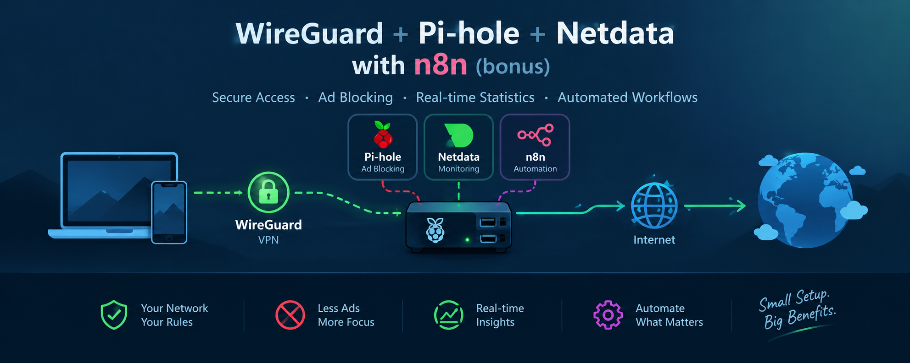
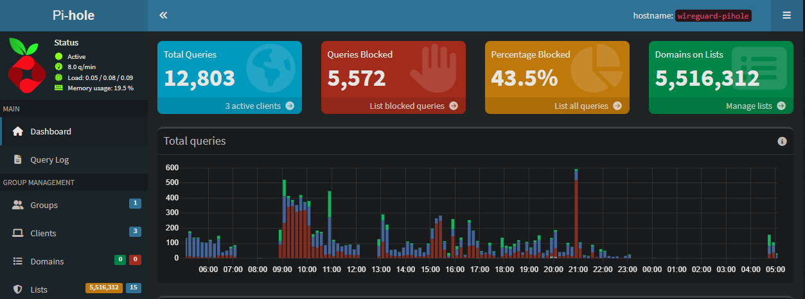
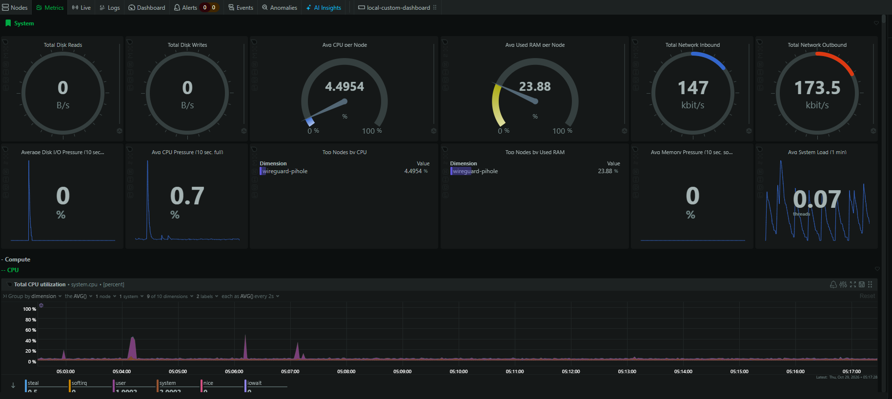
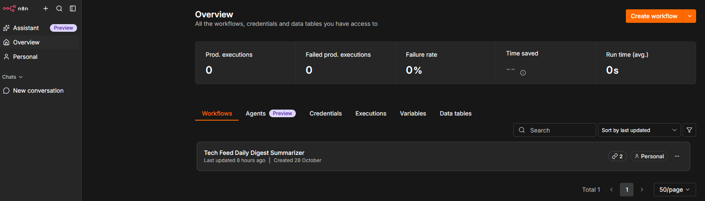

  

 
How to setup WireGuard with Pi-hole and Netdata for statistics (and n8n as a bonus :))

This runs completely free of charge on an Ubuntu 24.04 instance on Oracle Cloud Free Tier (shape VM.Standard.A1.Flex: 1 OCPU ; 6 GB memory ; 10 TB p/m free outbound internet traffic)

The webpages for Pi-hole, Netdata and n8n are only reachable on connected VPN clients!
 
 
 
<h2>Update Ubuntu first!</h2>
sudo apt update && sudo apt upgrade -y
 
 
<h2>Step 1: Add Ubuntu Firewall Rule for WireGuard internet access</h2>
  <i>NOTE: open this port in Oracle Cloud security list too!</i> 
   
sudo iptables -I INPUT 2 -p udp --dport 51820 -j ACCEPT 
sudo netfilter-persistent save (Make your iptables rules persistent across reboots) 
 
 
<h2>Step 2: Install Pi-hole</h2>
<i>Install Pi-hole first so PiVPN can pick it up automatically while installing in step 3!</i> 
 
sudo curl -sSL https://install.pi-hole.net | bash 
Follow steps in wizard 
 
Make Pi-hole admin page reachable for connected VPN clients: 
sudo iptables -I INPUT 3 -i wg0 -p tcp --dport 80 -j ACCEPT <i>(NOTE: must be above REJECT rule in INPUT section!->check with: sudo iptables -L -v -n)</i> 
sudo iptables -I INPUT 4 -i wg0 -p tcp --dport 443 -j ACCEPT <i>(NOTE: must be above REJECT rule in INPUT section!->check with: sudo iptables -L -v -n)</i> 
sudo netfilter-persistent save (Make your iptables rules persistent across reboots) 
 
<u>Pi-hole extra blocklists:</u> 
from https://blog.burstbytes.com.au/best-2026-pi-hole-blocklists-and-how-to-install-them/#How_to_install_a_Pi-hole_blocklist: 
- https://raw.githubusercontent.com/hagezi/dns-blocklists/main/adblock/multi.txt 
- https://raw.githubusercontent.com/hagezi/dns-blocklists/main/adblock/popupads.txt 
- https://raw.githubusercontent.com/hagezi/dns-blocklists/main/adblock/tif.txt 
- https://raw.githubusercontent.com/hagezi/dns-blocklists/main/adblock/fake.txt 
 
from https://github.com/zachlagden/Pi-hole-Optimized-Blocklists: 
- https://media.githubusercontent.com/media/zachlagden/Pi-hole-Optimized-Blocklists/main/lists/all_domains.txt 
 
from ex-colleague Paulus1337 (thanks Paul! ;-)): 
- https://raw.githubusercontent.com/StevenBlack/hosts/master/hosts 
- http://sysctl.org/cameleon/hosts 
- https://s3.amazonaws.com/lists.disconnect.me/simple_tracking.txt 
- https://justdomains.github.io/blocklists/lists/easylist-justdomains.txt 
- https://justdomains.github.io/blocklists/lists/easyprivacy-justdomains.txt 
- https://justdomains.github.io/blocklists/lists/adguarddns-justdomains.txt 
- https://justdomains.github.io/blocklists/lists/nocoin-justdomains.txt 
- https://nsfw.oisd.nl 
- https://big.oisd.nl 
- https://raw.githubusercontent.com/dashingdon/blocklists/refs/heads/master/pihole_addonblacklist.txt 
 
 
<h2>Step 3: Install WireGuard with PiVPN</h2>
  <i>or WG-Easy (=WireGuard + management GUI with Docker (not covered here))</i> 
 
sudo curl -L https://install.pivpn.io | bash 
Follow steps in wizard (choose WireGaurd instead of OpenVPN!) 
Now run 'pivpn add' to create the client profiles 
 
<u>Profile for iPhone example:</u> 
pivpn add iphone-vpn 
pivpn -qr iphone-vpn 
Scan QR code with the WireGuard app on your iPhone 
 
<u>Profile for laptop example:</u> 
pivpn add laptop-vpn 
cat ~/configs/laptop-vpn.conf 
Highlight and copy the entire output text from the terminal (starting from [Interface] down to the last line) 
On your Windows laptop, open Notepad (or any text editor) 
Paste the text into Notepad. 
Save the file as wg0.conf 
Import this file into the WireGuard windows application
 
 
<h2>Step 4: Install Netdata (Real-Time Server Performance Monitoring)</h2>
<i>Netdata provides an incredible, low-overhead real-time monitoring dashboard that will give you instant visibility into your network traffic</i> 
 
sudo wget -O /tmp/netdata-kickstart.sh https://get.netdata.cloud/kickstart.sh && sh /tmp/netdata-kickstart.sh 
sudo iptables -I INPUT 5 -i wg0 -p tcp --dport 19999 -j ACCEPT <i>(NOTE: must be above REJECT rule in INPUT section!->check with: sudo iptables -L -v -n)</i> 
sudo netfilter-persistent save (Make your iptables rules persistent across reboots) 
 
 
<h2>Step 5: Install n8n (Workflow Automation)</h2>
<i>n8n is a visual, node-based workflow automation platform that connects different apps, APIs, and AI agents so they can exchange data and run tasks automatically.</i> 
 
mkdir -p ~/n8n 
cd ~/n8n 
nano docker-compose.yml 
Paste the code and save <i>(NOTE:put N8N_SECURE_COOKIE=false in yml to be able to access site over http)</i> 
sudo apt install -y docker.io docker-compose-v2 (Install Docker and Docker Compose plugin) 
sudo systemctl enable --now docker (Start and enable Docker service) 
sudo usermod -aG docker $USER (Allow the ubuntu user to run Docker without sudo) 
newgrp docker (Allow the ubuntu user to run Docker without sudo) 
docker compose up -d (Start the service using Docker Compose) 
docker ps (Verify that n8n is running properly) 
sudo iptables -I INPUT 6 -i wg0 -p tcp --dport 5678 -j ACCEPT <i>(NOTE: must be above REJECT rule in INPUT section!->check with: sudo iptables -L -v -n)</i> 
sudo netfilter-persistent save (Make your iptables rules persistent across reboots) 
 
<i>docker compose down && docker compose up -d (if needed: This will gracefully shut down the container and spin it right back up with a clean restart)</i> 
 
 
<h2>The results</h2>
 
<i>Pi-hole</i>
 
 

  

 
<i>Netdata</i>
 
 

  

 
<i>n8n</i>
 
 

  

